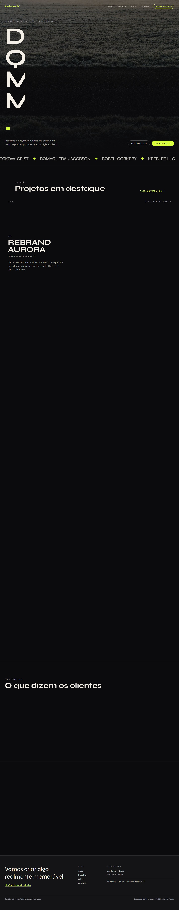
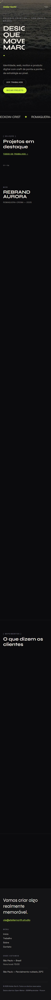
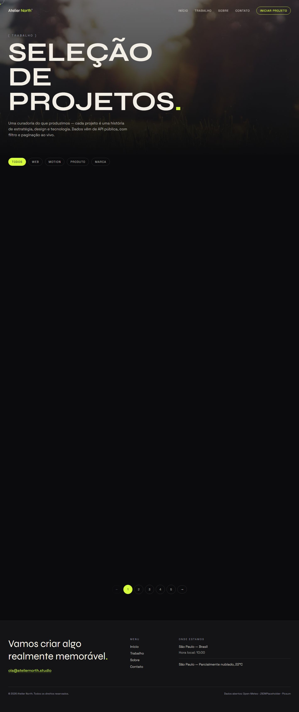
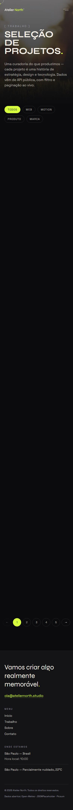
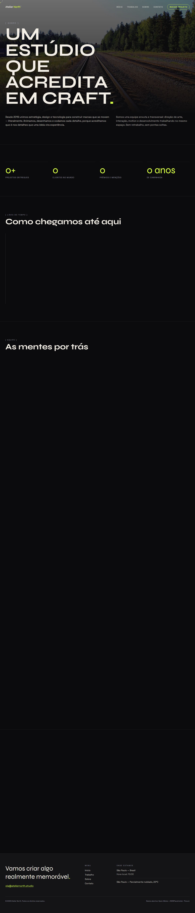
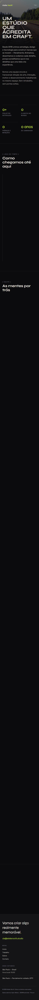
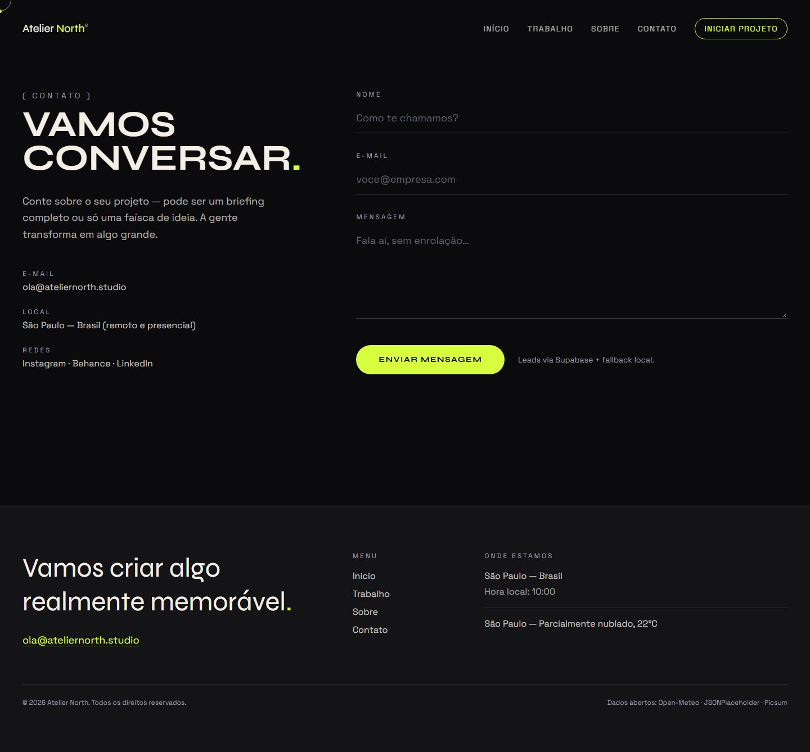
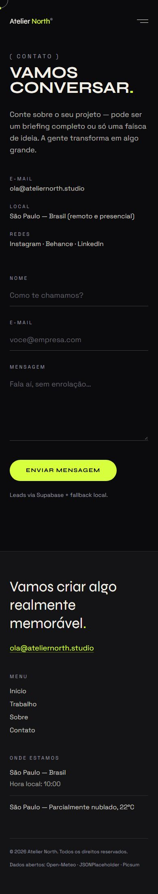

# Atelier North — Estúdio de Design & Tecnologia


> Site de agência nível Awwwards: smooth scroll, cursor custom, marquee, preloader e WebGL leve.
> Pilar **Showcase** · Semana 2 do roadmap · Milestone `m1-atelier-north` · Demo pública no GitHub Pages.

---

## Screenshots do Produto

### Home
| Desktop | Mobile |
|---------|--------|
|  |  |

### Trabalho
| Desktop | Mobile |
|---------|--------|
|  |  |

### Sobre
| Desktop | Mobile |
|---------|--------|
|  |  |

### Contato
| Desktop | Mobile |
|---------|--------|
|  |  |

> **Baselines:** 8 screenshots (4 páginas × desktop/mobile) versionadas em `docs/screenshots/`, geradas por `e2e/screenshots.spec.ts` (Playwright). Regerar com `npm run e2e:screenshots`.

---

## Documentação

| Arquivo | Descrição |
|---------|-----------|
| [`docs/atelier-north-case.md`](./docs/atelier-north-case.md) | Case study: contexto, desafio, solução, métricas e "o que aprendi" |
| [`docs/a11y/relatorio-axe.json`](./docs/a11y/relatorio-axe.json) | Relatório de acessibilidade (axe) das 4 páginas |
| [`docs/clarity-integracao.md`](./docs/clarity-integracao.md) | Integração do Microsoft Clarity (mapa de calor) |
| [`docs/manter-online.md`](./docs/manter-online.md) | Estratégia zero-standby (custo zero) |

---

## Setup Rápido

```bash
npm install          # instala dependências
npm start            # ng serve → http://localhost:4200
```

O app funciona sem backend: os dados vêm de APIs públicas (JSONPlaceholder, Picsum, Open-Meteo) e o formulário de contato cai em **modo demo local** quando o Supabase não está configurado.

---

## Comandos Principais

| Comando | Descrição |
|---------|-----------|
| `npm start` | Servidor de desenvolvimento (`ng serve`) |
| `npm run build` | Build de produção (`ng build`) |
| `npm run lint` | ESLint + angular-eslint |
| `npm test` | Testes unitários (Vitest, watch) |
| `npm run test:ci` | Testes unitários + cobertura (CI) |
| `npm run e2e` | Playwright (smoke + axe + screenshots) |
| `npm run e2e:smoke` | Somente o smoke E2E (navegação + a11y) |
| `npm run e2e:a11y` | Varredura de acessibilidade (gera relatório axe) |
| `npm run e2e:screenshots` | Regenera os prints do README |
| `npm run analyze` | Análise de bundle (`ng build --stats-json`) |

---

## Telas Implementadas

| Tela | Rota | Conteúdo |
|------|------|----------|
| Início | `/` | Hero com split text + parallax, marquee de clientes, showcase com pin, CTA |
| Trabalho | `/work` | Grade filtrável por categoria + paginação |
| Sobre | `/about` | Timeline editorial (2019→2026), contadores animados, equipe |
| Contato | `/contact` | Formulário validado (Signal Forms/Reactive Forms) → Supabase `leads` com fallback demo |

---

## Qualidade & Performance

| Métrica | Resultado |
|---------|-----------|
| **Unit tests (Vitest)** | 69/69 passando (22 arquivos) |
| **Cobertura** | 72,5% statements · 72,2% branches · 69,1% lines |
| **E2E (Playwright)** | 12/12 passando (smoke, axe, screenshots) |
| **Acessibilidade (axe)** | 0 violações graves/críticas nas 4 páginas |
| **Lighthouse** | Performance **70** · A11y **100** · Best Practices **96** · SEO **100** |
| **ESLint** | 0 erros · 0 warnings |
| **Bundle inicial** | 460 kB (≈133 kB transfer) |
| **Responsivo** | mobile (390) / desktop (1440) |

> Perf 70 é trade-off consciente: GSAP + Lenis custam ~300 ms de JS para entregar a sensação Awwwards. Otimizado com WebP no hero, `fetchpriority="high"` e fontes assíncronas. A meta de perf ≥ 90 fica para a fase de performance do roadmap (Semana 10).

---

## Acessibilidade

Varredura automatizada com `@axe-core/playwright` (tags WCAG 2.0/2.1 A+AA) nas quatro páginas — **zero violações** graves ou críticas.

- Guarda `canAnimate()` + `@media (prefers-reduced-motion: reduce)` **zeram** animações; cursor custom e smooth scroll só existem com `pointer: fine`.
- Textos decorativos com `aria-hidden` + conteúdo real em `sr-only`; slides do showcase alternam `aria-hidden` conforme o progresso real.
- Contraste pensado (`cream/70–80` sobre `ink`) e foco visível em `acid`.
- Relatório versionado em [`docs/a11y/relatorio-axe.json`](./docs/a11y/relatorio-axe.json). Reproduzir: `npm run e2e:a11y`.

---

## SEO & AI discovery

- `public/robots.txt` e `public/sitemap.xml` servidos como arquivos estáticos (não caem no fallback SPA).
- `public/llms.txt` e `public/ai-catalog.json` (+ `public/.well-known/ai-catalog.json`): descoberta por LLMs/agentes.
- `index.html` com `description`, Open Graph e `theme-color`.

---

## Design — decisão e intenção

> Cada escolha abaixo tem um "para quê" — nada é decorativo solto.

### Conceito

**"Atelier North — design que move marcas"** é um estúdio fictício de São Paulo. O site se comporta como um *case* de estúdio Awwwards: escuro, cinematográfico e editorial, onde o movimento do scroll conta a história de um ateliê que transforma marca em experiência.

### Identidade visual

| Token | Valor | Para quê |
|-------|-------|----------|
| `ink` `#0b0b0d` / `ink-soft` `#141417` | tinta quase preta | Palco escuro que faz os acessos saltarem; base do clima cinematográfico |
| `cream` `#f3efe6` | creme/off-white | Texto principal — contraste suave (não branco puro), tom de papel de ateliê |
| `acid` `#d8ff3e` | verde-ácido | Ação: CTA, links ativos, seleção, pontos de timeline — **delata o que é clicável** |
| `clay` `#ff5c39` | terracota | Erro/estado crítico (formulário) — do mesmo universo cromático |
| `mute` `#9b9ba3` | cinza | Microetiquetas e metadados — hierarquia sem gritar |

- **Tipografia:** `Syne` (display) para títulos gigantes em caixa alta com `leading-[0.92]`; `Space Grotesk` (corpo). Contraste brutal de escala entre o título em `clamp(3rem↔12rem)` e as microetiquetas `uppercase tracking-[0.3em]`.
- **Formas e consistência:** botões-pílula `rounded-full`; seções separadas por `border-white/10`; rótulos no padrão `( … )`; `::selection` e `:focus-visible` em acid.

### Estratégia de movimento

| Peça | Implementação | Intenção |
|------|---------------|----------|
| Preloader | Marca "Atelier North®" + estado de "ready" | Ritual de entrada — anuncia que o site é "trabalho" antes de abrir o hero |
| Hero | `SplitText` em linhas com máscara + `stagger` após o preloader; capa WebP com parallax (scrub) | O nome da marca entra em camadas, com timing de abertura de filme |
| Showcase | `ScrollTrigger` com `pin` que troca de slide com o progresso do scroll | Rolagem vira **edição**: o visitante "empurra" o portfólio com o próprio scroll |
| Cursor custom | Anel + ponto acid, `mix-blend-difference`, `quickTo` (lerp) e ampliação sobre interativos | A mão responde a cada elemento; só ativa em `pointer: fine` |
| Smooth scroll (Lenis) + `appReveal` | Lenis substitui o scroll nativo; blocos revelam ao entrar na viewport | Troca o "pulo" do scroll por fluidez constante — a assinatura Awwwards |
| Contadores & timeline | `app-counter` anima os números; timeline editorial com pontos acid | Concretiza a narrativa "desde 2019" — o passado vira prova |
| Marquee | Clientes em loop infinito (CSS `--marquee-duration`) | Sensação de vitrine viva |

### Trade-off consciente

GSAP + Lenis custam ~300 ms de JS na simulação mobile — o preço é a **sensação** Awwwards. A resposta foi otimizar o que dá (WebP, preload, fontes) e documentar o resto, em vez de cortar a assinatura visual.

---

## Dados e conteúdo (sem backend próprio)

- **Dados públicos:** JSONPlaceholder (projetos/clientes/depoimentos), Picsum (imagens WebP) e Open-Meteo (clima).
- **Leads:** Supabase (`leads`, slug `agency`) com **fallback local** quando `VITE_ROLE=demo` — o formulário funciona sempre, mesmo sem credenciais.
- **Racional de performance:** WebP + `fetchpriority="high"` no hero, `loading="lazy"` no resto, fontes async.

Ambiente (`.env`, nunca commitado):

```
VITE_SUPABASE_URL=
VITE_SUPABASE_ANON_KEY=
VITE_ROLE=demo
```

---

## Decisão de teste: Vitest

> Cada repo do roadmap alterna Karma/Vitest de propósito: agnóstico de ferramenta, escolha por contexto.

Neste repo o contexto é um **showcase visual** com navegação multi-página e lógica de estado:

- **Nativo ESM + TypeScript:** o Vitest transforma os specs no Vite, mesmo pipeline do `ng build`.
- **CI sem browser:** roda em Node puro, deixando o job de testes mais rápido e estável que o Karma.
- **Karma em fim de vida:** o Angular já o marca como deprecated.
- **Watch mode instantâneo:** feedback imediato ao refinar animações e componentes.
- **Cobertura V8 embutida:** cobertura/lcov nativos, sem plugin extra.
- **API familiar:** `describe/it/expect` no mesmo formato do Karma/Jasmine.

---

## Estrutura do Projeto

```text
src/
├─ app/
│  ├─ core/                 # guards de animação, models e services (json/picsum/meteo/supabase)
│  ├─ features/             # páginas: home, work, about, contact (lazy)
│  └─ shared/               # header, footer, cursor, preloader, showcase, marquee, counter…
├─ environments/
└─ index.html
e2e/                        # Playwright: smoke, acessibilidade (axe), screenshots
docs/                       # case study, a11y, screenshots, runbooks
.github/workflows/          # CI (lint→build→unit→e2e→lighthouse) + Deploy (GitHub Pages)
```

---

## Stack

| Responsabilidade | Tecnologia |
|------------------|------------|
| Framework | Angular 22 (standalone, signals, zoneless, OnPush) |
| Linguagem | TypeScript |
| Estilização | Tailwind CSS 4 |
| Animação | GSAP + ScrollTrigger + SplitText · Lenis (smooth scroll) |
| Backend/Dados | Supabase (Postgres + Auth + RLS) · APIs públicas |
| Testes | Vitest (unit) · Playwright + axe (E2E/a11y) |
| Qualidade | ESLint + angular-eslint · Lighthouse CI |
| Deploy | GitHub Pages (site estático) |

---

## Branches & Workflow Git

```text
main      → produção (build estático; push dispara deploy no GitHub Pages)
homolog   → validação/release de PRs (staging)
develop   → integração diária (merges das feat/*)
feature   → feat/<assunto> + PR para develop
```

- **Commits:** `feat:`, `fix:`, `test:`, `docs:`, `design:`, `ops:`, `backend:` (Conventional Commits)
- **PRs:** via pull request template; revisados e mergeados por milestone
- **main:** protegida — merge somente via PR de `homolog`
- Rastreabilidade com issues, labels (`feat/test/design/ops/backend`) e milestones

---

## Bots (estação local + CI)

Os bots vivem em `bots/` e rodam localmente e no GitHub Actions. Cada um olha uma dimensão que o outro não enxerga.

| Bot | O que faz | Como roda localmente |
|-----|-----------|----------------------|
| **Humano** (`bots/humano/navegacao-humana.mjs`) | Navega com comportamento de pessoa real (cliques com atraso, scroll gradual, hesitação). Detecta travamento, loop de animação e navegação quebrada. | `BOT_URL=http://localhost:4200 node bots/humano/navegacao-humana.mjs` |
| **Analisador de erros** (`bots/analise-erros/analisador.mjs`) | Lê logs de build/e2e/CI, classifica por severidade e aponta padrões repetidos. | `node bots/analise-erros/analisador.mjs` |
| **CI + Lighthouse** | `npm ci` → lint → build → Vitest (coverage) → Playwright + axe → Lighthouse. | `npm run build` + `npx lhci autorun` |

---

## Microsoft Clarity (mapa de calor)

Integração **condicional** via `src/main.ts` (injetada no `<head>` só quando `environment.clarityProjectId` é definido). Grava mapa de calor, scroll, cliques e sessões reais — a "comunicação" que fecha o ciclo dos bots. Ver [`docs/clarity-integracao.md`](./docs/clarity-integracao.md).

---

## Deploy

- **GitHub Pages** (projeto público): `https://zecki1.github.io/angular-atelier-north/`
  Workflow [`.github/workflows/deploy-pages.yaml`](./.github/workflows/deploy-pages.yaml) — build com `--base-href=/angular-atelier-north/` + fallback SPA (`index.html` → `404.html`).
- **Política do workspace:** projetos públicos → GitHub Pages; projetos privados → Vercel (config em `vercel.json`).
- Estratégia zero-standby documentada em [`docs/manter-online.md`](./docs/manter-online.md).

---

## Links Úteis

- **Produção (GitHub Pages):** https://zecki1.github.io/angular-atelier-north/
- **Repositório:** https://github.com/zecki1/angular-atelier-north
- **Roadmap do portfólio:** `planejamento-projetos.md` (Semana 2 — Atelier North)

---

## Licença

MIT — ver [`LICENSE`](./LICENSE).
